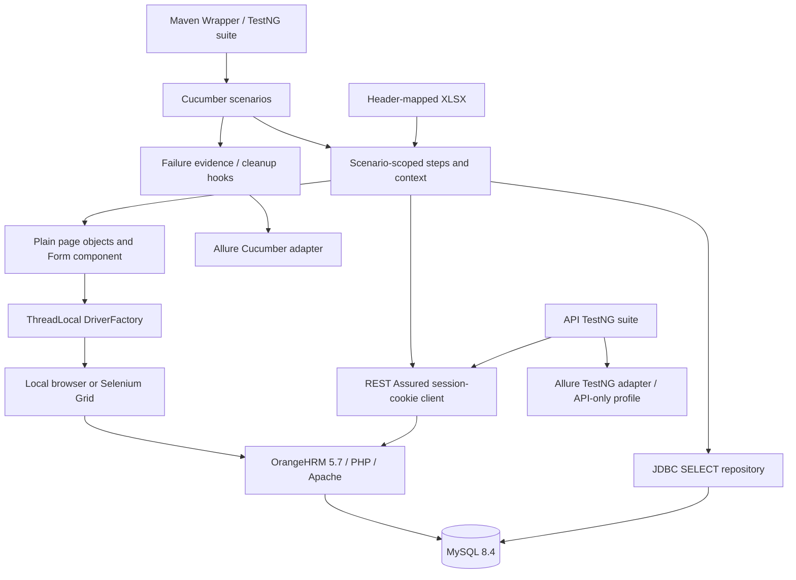

# Architecture and one scenario walkthrough



UI-011 begins with a clean browser and a PicoContainer-owned `ScenarioContext`. The administrator step uses `LoginPage.admin()` to complete real session/CSRF authentication. `EmployeeApi` captures cookies in memory for fixture cleanup. `EmployeePage.add()` opens Add Employee; the context supplies a unique nine-character employee ID.

`I fill employee dataset "minimal"` opens the XLSX with Apache POI, maps headers, finds the requested row and closes both stream and workbook. First name Qa, empty middle and surname Synthetic become an immutable `Employee` record. `saveCreated()` clicks Save and waits for the personal-details redirect, then captures `empNumber` from the verified route.

The final step reads persisted names and ID through a prepared SELECT using the reader account. `assertEmployee` compares every selected business value. UI inputs are checked as well. If this assertion fails, the hook captures evidence before browser shutdown. Cleanup searches the owned ID through the application API, deletes matching owned records, and verifies absence in MySQL. Finally, `quit()` and ThreadLocal removal run even if cleanup fails.

An update scenario first creates its own employee through the real API, opens personal details in the UI, changes one name, saves, reloads and compares UI/MySQL values. Delete uses the table's delete action and confirms absence in both MySQL and search. Read-only and non-database scenarios are classified in ui-coverage.csv; navigation and validation are not falsely described as database writes.

The JDBC repository binds the recorded ID as the single `?` parameter. For manual execution, substitute only the owned synthetic ID using your SQL client's bind-parameter support:

```sql
SELECT emp_firstname, emp_middle_name, emp_lastname, employee_id
FROM hs_hr_employee
WHERE employee_id = ?;
```

One exact matching row is expected after create/update; zero rows after deletion or cancelled/invalid creation. Database schema lengths are not UI validation limits.

ThreadLocal isolates browser handles; scenario context isolates business data. These solve different problems. Unique IDs prevent cross-browser fixture collisions. One scenario worker per browser matches one node slot; the benchmark starts two browser processes for cross-browser parallel execution. Suites contain one primary Cucumber runner, avoiding accidental duplicate discovery.
